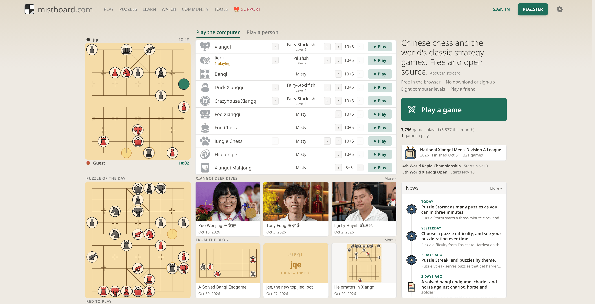

# [Mistboard](https://mistboard.com)

[](https://github.com/brianhliou/mistboard/actions/workflows/ci.yml)
[](LICENSE)



> **Bring people together across cultures through Chinese chess and the world's classic strategy games.**

Mistboard is a free, open-source site for playing and studying Chinese chess, in
English, Simplified Chinese and Traditional Chinese.

## On the site

- **Games.** Xiangqi, Jieqi and Banqi lead. Beside them: Duck Xiangqi, Fog
  Xiangqi, Crazyhouse Xiangqi, Xiangqi Mahjong, Jungle Chess, Flip Jungle and
  Fog Chess. Rules for each are at [mistboard.com/rules](https://mistboard.com/rules).
- **Play.** Link games with no account, a lobby, rated play, correspondence,
  and computer opponents at eight levels.
- **Study.** Puzzles from real games, a beginner course, studies, an analysis
  board and a games database.
- **Watch.** Live games, tournament broadcasts and replays of every finished game.
- **Engines.** Engine authors challenge for titles in public matches. The
  [engine protocol](docs/engine-protocol.md) defines what an engine is sent.

## Run it locally

Needs Node.js 22 or newer, and Docker for the default database.

```bash
npm install
npm run dev          # Postgres in Docker, migrations, server and web
npm run dev:memory   # no Docker; database-backed pages stay empty
```

Open `http://localhost:3000`. Check your work with `npm test` and `npm run typecheck`.

Dev pairs listen on `127.0.0.1` by default. For phone testing on the same
network, run `MISTBOARD_DEV_LAN=1 npm run dev` (or `npm run dev:memory` with
the same prefix) and open `http://<your-Mac-LAN-address>:3000` on the phone.
The same opt-in applies to the standalone web and agent dev commands.

Run `npm run db:seed:qa` to fill the local home and index surfaces. Its
`db:seed:volume` step adds ten fictional games per public product variant,
eight forum topics with replies, six public studies and six lobby chat messages.
The forum and study counts match the homepage's fetch windows; News already
uses the committed announcements. No production player data is fetched.

The volume step accepts only a loopback Postgres URL and can be re-run across
worktrees: it refreshes its own fixtures under a transaction lock and preserves
other data. Games use deterministic legal play with a resignation at the move
cap. Two games per variant with stored analysis support have **synthetic**
advantage scores for layout QA, not engine evaluations. Review examples:
`/jieqi/game/jq_qa_volume_00`, `/xiangqi/game/xq_qa_volume_00`, and
`/banqi/game/bq_qa_volume_00`. The seed prints all chart review paths.

Run the production probes locally before deploying:

```bash
npm run smoke:local
# Reuse the exact build just checked by the release gate:
npm run smoke:local -- --skip-build
```

This command builds both apps, ensures the shared Postgres on port 5435, creates
its own uniquely named `mistboard_smoke_*` database, migrates and seeds the
committed finished-game fixtures for every checked variant, and starts a server
serving the built web app on port 3099. It also starts its own local engine
service for Fog Xiangqi. It stops its services and drops its database on success
or failure. It ignores inherited `DATABASE_URL` and production base URLs, so it
never seeds or reads the shared dev database. Use `-- --port 3119` for another
worktree. The built app supplies production framing headers and prerendered pages.
Its build enables the product profile's browser flags and verifies source maps
offline. `--skip-build` requires an existing build with those flags enabled.

The gate runs the site, correspondence and builtin-engine checks, the seven
main variant PvE smokes (Fog Xiangqi, Duck, Xiangqi, Jieqi, Banqi, Jungle and Flip
Jungle), and every ceval backend. Banqi review uses the seeded fixture's explicit
room ID, never a game discovered in the watch feed. The server enables
`builtin-random-legal` for its engine probe. Probes run sequentially, and an early
failure cannot hide a ceval regression.

Only a proven missing native engine executable may report `SKIPPED`, with its
name and configuration hint. Every other failure, disabled-variant skip,
assets-only result or missing success result fails the gate. Browser WASM checks
always run. Install Chromium with `npx playwright install chromium` when preparing
the machine; a blocked or unavailable browser fails the stage.

`release:prod` invokes the same runner through `release:local-smoke` before
draining or pushing, including its build with the browser flags enabled.
No `--skip-local-ci` is needed for absent native binaries. To inspect the
probe plan without running it, use
`node scripts/local-prod-smoke.mjs --base http://127.0.0.1:3099 --plan`.
Choosing an automatic gate for the broader `tests/e2e/` suite remains a separate
step.

## Code

```text
packages/game           Rules, visibility, variants, clocks, replay
packages/board-render   Shared SVG board rendering
apps/server             WebSocket rooms, clocks, event log, HTTP API
apps/web                Vite browser client
```

The server holds every game's full state and sends each player only what they
may see. [docs/ARCHITECTURE.md](docs/ARCHITECTURE.md) has the data flow, and
[docs/README.md](docs/README.md) lists the rest of the documentation.

## Contributing

Read [CONTRIBUTING.md](CONTRIBUTING.md) and the
[Code of Conduct](CODE_OF_CONDUCT.md). Report security problems privately, as
[SECURITY.md](SECURITY.md) describes. Bugs and requests go to
[GitHub issues](https://github.com/brianhliou/mistboard/issues).

## License

AGPL-3.0-or-later; see [LICENSE](LICENSE). For other terms, such as closed-source
use, write to [mistboard.com/contact](https://mistboard.com/contact). The project
name and hosted service are covered in [GOVERNANCE.md](GOVERNANCE.md), and
credits are at [mistboard.com/thanks](https://mistboard.com/thanks).
