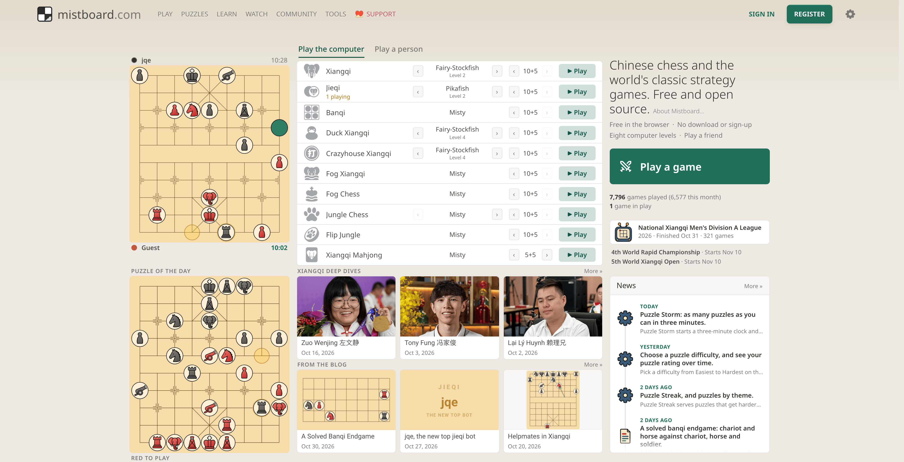

# [Mistboard](https://mistboard.com)

[](https://github.com/brianhliou/mistboard/actions/workflows/ci.yml)
[](LICENSE)



> **Bring people together across cultures through Chinese chess and the world's classic strategy games.**

Mistboard is a free, open-source site for playing and studying Chinese chess, in
English, Simplified Chinese and Traditional Chinese.

## On the site

- **Games.** Xiangqi, Jieqi and Banqi lead. Beside them: Duck Xiangqi, Fog
  Xiangqi, Crazyhouse Xiangqi, Xiangqi Mahjong, Jungle Chess, Flip Jungle and
  Fog Chess. Rules for each are at [mistboard.com/rules](https://mistboard.com/rules).
- **Play.** Link games with no account, a lobby, rated play, correspondence,
  and computer opponents at eight levels.
- **Study.** Puzzles from real games, a beginner course, studies, an analysis
  board and a games database.
- **Watch.** Live games, tournament broadcasts and replays of every finished game.
- **Engines.** Engine authors challenge for titles in public matches. The
  [engine protocol](docs/engine-protocol.md) defines what an engine is sent.

## Run it locally

Needs Node.js 22 or newer, and Docker for the default database.

```bash
npm install
npm run dev          # Postgres in Docker, migrations, server and web
npm run dev:memory   # no Docker; database-backed pages stay empty
```

Open `http://localhost:3000`. Check your work with `npm test` and `npm run typecheck`.

## Code

```text
packages/game           Rules, visibility, variants, clocks, replay
packages/board-render   Shared SVG board rendering
apps/server             WebSocket rooms, clocks, event log, HTTP API
apps/web                Vite browser client
```

The server holds every game's full state and sends each player only what they
may see. [docs/ARCHITECTURE.md](docs/ARCHITECTURE.md) has the data flow, and
[docs/README.md](docs/README.md) lists the rest of the documentation.

## Contributing

Read [CONTRIBUTING.md](CONTRIBUTING.md) and the
[Code of Conduct](CODE_OF_CONDUCT.md). Report security problems privately, as
[SECURITY.md](SECURITY.md) describes. Bugs and requests go to
[GitHub issues](https://github.com/brianhliou/mistboard/issues).

## License

AGPL-3.0-or-later; see [LICENSE](LICENSE). For other terms, such as closed-source
use, write to [mistboard.com/contact](https://mistboard.com/contact). The project
name and hosted service are covered in [GOVERNANCE.md](GOVERNANCE.md), and
credits are at [mistboard.com/thanks](https://mistboard.com/thanks).
